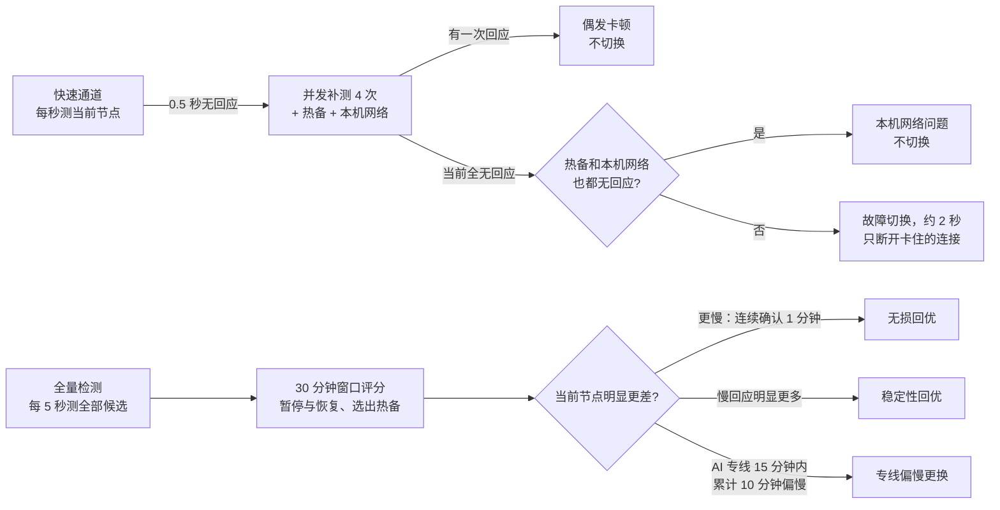

# 稳航 SteadyRoute

稳航是一个跑在 macOS 上的 Clash Verge / Mihomo 家宽线路控制器。它照看 Clash 里正在用的每条线路：按当前节点的国家锁定，只在这个国家的家宽节点之间切换；当前节点每秒检测一次，断线约 2 秒内换到同国家的家宽热备；节点没坏但明显变慢、或者慢回应明显偏多时，在不打断现有连接的前提下换到更好的同国家家宽；并在本机提供看板、设置页和使用说明。

可选的 **AI 家宽专线**：在设置页选一个国家，稳航在 Clash 里建立只含该国家家宽节点的专线，ChatGPT、Claude 等 AI 服务的规则（以 [ip.net.coffee](https://ip.net.coffee/) 为第一优先级，每周自动同步）排在所有规则之前，节点全部不可用时拒绝连接，不会回落到直连。

- 当前版本：**v0.6.0**（2026-10-21）。各版本的安装包见 [Releases](https://github.com/z13141557217-web/steadyroute/releases)。
- 需要：macOS、系统自带的 Python 3.9 或更新、[Clash Verge Rev](https://github.com/clash-verge-rev/clash-verge-rev)（内核 mihomo；AI 专线需要 v1.19.27 或更新）。
- 只用 Python 标准库，没有第三方依赖。单进程，由 LaunchAgent 开机自启、异常自动拉起。
- 不改订阅，不上传任何数据。只有在设置页确认后才会往 Clash 写入专线，关闭即完整撤销。所有页面只监听 `127.0.0.1:17654`。

## 一分钟看懂

| 你关心的 | 稳航怎么做 | 数字 |
|---|---|---|
| 节点断了多久能换走 | 当前节点每秒测一次；0.5 秒没回应立刻并发补测 4 次，同时测热备和本机网络；全都确认才切 | 从节点断开到切走约 2 秒 |
| 偶尔丢个包会不会乱切 | 补测中只要有一次回应就不切 | 卡不到约 1.5 秒都不切 |
| 会不会换到别的国家 | 不会。三层检查，越界的切换直接拒绝 | 0 例外 |
| 切换会不会打断正在用的网页、AI 回答 | 故障切换只断开卡住的连接；回优类切换完全不断开 | 仍在收数据的连接都保留 |
| 选哪个节点 | 每 5 秒测全部候选，按最近 30 分钟的慢请求延迟、失败率和慢回应综合评分 | 每个节点约 360 个样本 |
| 坏节点什么时候能再用 | 连续成功 5 次即恢复，没有固定等待 | 约 25 秒（反复出问题的 50 / 100 秒） |
| 会不会一直换出口 | 回优有门槛、冷却和每日上限；手动选的节点 1 小时内不动 | 稳定性回优每天最多 6 次 |
| 出了问题怎么查 | 设置页一键复制诊断信息、下载检测记录 | 诊断信息约 60 KB 以内 |

---

## 目录

- [快速开始](#快速开始)
- [它解决什么问题](#它解决什么问题)
- [铁律：只在同地区家宽之间切换](#铁律只在同地区家宽之间切换)
- [工作原理](#工作原理)
  - [检测节奏](#检测节奏)
  - [故障切换](#故障切换)
  - [为什么是约 2 秒](#为什么是约-2-秒)
  - [选哪个节点](#选哪个节点)
  - [暂停与恢复](#暂停与恢复)
  - [三种主动更换](#三种主动更换)
  - [手动选择、休眠与本机断网](#手动选择休眠与本机断网)
  - [节点状态](#节点状态)
- [AI 家宽专线](#ai-家宽专线)
- [看板与页面](#看板与页面)
- [排查问题：诊断信息与检测记录](#排查问题诊断信息与检测记录)
- [安装、升级与卸载](#安装升级与卸载)
- [日志与数据](#日志与数据)
- [资源占用与流量](#资源占用与流量)
- [隐私与安全](#隐私与安全)
- [仓库结构](#仓库结构)
- [开发、测试与发布](#开发测试与发布)
- [版本历史](#版本历史)
- [路线图](#路线图)
- [文档索引](#文档索引)

---

## 快速开始

新装、升级、换电脑都是同一步。第一次：

```bash
git clone https://github.com/z13141557217-web/steadyroute.git ~/Projects/steadyroute
cd ~/Projects/steadyroute && ./install.command
```

以后升级：

```bash
cd ~/Projects/steadyroute && git pull && ./install.command
```

不用 git 也可以：在 [Releases](https://github.com/z13141557217-web/steadyroute/releases) 下载 `SteadyRoute-v<版本>.zip`，解压后右键 `install.command` → 打开。

装好后会自动打开看板 <http://127.0.0.1:17654/>。稳航会：

1. 找出 Clash 里直接选中节点的分组，按当前节点的国家锁定，开始每 5 秒检测这个国家的全部家宽节点。
2. 第一分钟内攒够样本，选出热备；之后当前节点每秒检测一次。
3. 设置、状态和节点历史在升级时保留；从旧版升级时会提示是否把旧线路升级为新格式。

AI 家宽专线在看板右上角的“设置”里开启，选一个国家即可，写入前会列出所有改动等你确认。

---

## 它解决什么问题

AI 服务对出口 IP 很敏感。出口在不同地区之间来回跳，或者从家宽变成机房 IP，都可能触发额外验证。Clash 自带的 `url-test` / `fallback` 只看一次测速的快慢，会出现以下问题：

| Clash 自带策略的问题 | 稳航的做法 |
|---|---|
| 只按单次测速选，抖一下就换，出口频繁变化 | 按最近 30 分钟约 360 次检测的慢请求延迟、失败率、慢回应和 24 小时可用率综合判断；更换有门槛、要连续确认、有冷却和每日上限 |
| 节点断了要等下一次测速（分钟级）才发现 | 当前节点每秒探测，0.5 秒无回应即并发补测，断线到切走约 2 秒；偶尔丢一个包不切 |
| 换节点会打断正在进行的对话、上传 | 回优类切换旧连接保留到自然结束；故障切换只断开卡住的连接 |
| 候选列表写死，订阅换了节点名就失效 | 每轮从订阅里重新取同国家的家宽，新节点预热后参与选路 |
| 坏节点要么一直用，要么关很久 | 失败即暂停，连续成功 5 次即恢复，不设固定隔离时长 |
| 本机断网、合盖休眠、网站自己挂了，都会被当成节点故障 | 用热备和直连做对照，这些情况都能识别，不冤枉节点 |
| 不知道它为什么换、什么时候换 | 看板直接显示原因和下一步；每次决策写入结构化日志；诊断信息一键复制 |

---

## 铁律：只在同地区家宽之间切换

> **每条线路锁定一个国家，只会换到这个国家的家宽：台湾线路只用台湾家宽，香港线路只用香港家宽。**

这条规则没有例外。同地区的家宽全部不可用时，稳航保持当前选择、继续检测，并在看板上用红色提示，不会为了“能连上”而换到其他地区或机房节点。

规则在三层都有检查：

1. **生成策略时**：每轮按分组当前节点的国家生成策略，候选只取同国家、名称带家宽标记的节点。
2. **选路前**：候选列表按国家和家宽规则再过滤一次。
3. **向 Mihomo 下发切换（`PUT`）前**：最后一次校验，越界的选择直接拒绝并记录。

候选节点按名称识别（[`regions.py`](src/steadyroute/regions.py)）：

- 国家：中英文名、常见缩写和国旗，例如“台湾 / 台灣 / 🇹🇼 / TW”。
- 家宽：“家宽 / 住宅 / Residential / ISP / HiNet / Seednet / HKT / HKBN”等。
- 排除“到期、剩余流量、官网”这类提示条目，以及 Clash 内置出口（`DIRECT`、`REJECT`、`PASS-RULE` 等）和分组。

AI 家宽专线在 Clash 层面同样遵守这条规则：分组只包含所选国家的家宽节点，节点全部不可用时拒绝连接（`empty-fallback: REJECT`），不会回落到直连。

`DIRECT` 只用于只读的本机网络检测，任何路径都不会把线路切到 `DIRECT`。

---

## 工作原理



### 检测节奏

| 检测 | 频率 | 内容 |
|---|---|---|
| 快速通道 | 每 1 秒 | 只测当前节点：纯 HTTP 204，1.5 秒超时，0.5 秒没回应即起疑。在单独的线程里运行，完整检测再慢也不会耽误它 |
| 全量检测 | 每 5 秒一轮（固定速率） | 这条线路的全部候选：HTTPS 连通与延迟，失败的同轮重试一次。每条线路评分最好的 5 个始终每 5 秒；其余 24 小时可用率不足 90% 且未暂停的节点每 30 秒一次 |
| 业务检测 | 每 60 秒 | 通过当前节点和热备打开检测页（AI 专线：ChatGPT、Claude 的网页与 API 地址），确认不只是“能连上”，而是“能用” |
| 本机网络 | 起疑时 | 绕开代理直接测，区分“节点坏了”和“本机没网” |

### 故障切换

1. **起疑**：当前节点的探测 0.5 秒没有回应。
2. **并发补测**：立刻再测 4 次（间隔 0.15 秒，各等 0.7 秒），同时测热备和本机网络。起疑的那次探测如果稍后回应了，也算有回应。
3. **确认**：当前节点一次都没有回应、热备或本机网络正常，才算故障。从节点停止回应到这里约 2 秒。
4. **切换**：换到同地区热备。热备 120 秒内没有业务检测成功时，先确认它能打开 AI 网站再换。热备优先选达标的节点（最近 30 分钟成功率 ≥ 95%、24 小时可用率 ≥ 90%）；一个达标的都没有时，选当前能连通、评分最好的节点，不停在已断开的节点上。
5. **断开**：确认的这 2 秒里没有收到数据的连接被断开，浏览器和应用会马上在新节点重连，页面不会一直转圈；仍在收数据的连接保留。

以下情况**不会**切换：

- 补测中有任何一次回应：偶尔丢一个包、卡不到约 1.5 秒。
- 热备和本机网络也都没有回应：本机断网，或者刚从休眠醒来、网络还没好。
- Mac 刚从休眠醒来的第一轮完整检测：只记录成功的结果，不做切换决策。
- 这一轮所有节点同时失败：判断为本地或 Clash 的问题。
- 当前节点和热备都打不开同一个 AI 网站：这是网站故障，5 分钟内预检跳过该网址。
- 当前节点处于“暂停”但还有回应：暂停只影响它能不能被选为目标，不会把正在用的节点切走。

**故障风暴保护**：10 分钟内故障切换达到 3 次后，每次切换前都必须完整验证目标节点能打开 AI 网站。

### 为什么是约 2 秒

节点一旦停止回应，必须等一小段时间才能区分“卡一下”和“断了”。v0.6.0 用模型比较了几种做法（[`sim/detection/`](sim/detection/)、[ADR-0009](docs/adr/0009-detection-v06.md)）。模型按真实诊断里的探测值设定延迟分布（多数 60–100 ms，常有 150–700 ms，偶有 1–2.5 秒），断线分为短暂卡顿、几秒的停顿和真实断线三类；下表取与实测切换频率最接近的一组：

| 做法 | 断线后切走（中位 / 九成） | 误切 / 天 | 网页等待超过 3 秒 / 天 | 当前节点探测 / 天 |
|---|---|---|---|---|
| v0.5.4（每 5 秒，补测 2 次） | 6.7 / 8.8 秒 | 1.8 | 3.2 | 1.7 万 |
| 每 100 ms，连续 5 次失败就切 | 1.4 / 1.4 秒 | 22.2 | 0 | 86 万 |
| 每 100 ms，连续 10 次失败就切 | 1.9 / 1.9 秒 | 4.9 | 0 | 86 万 |
| **v0.6.0（每 1 秒，0.5 秒起疑，并发补测 4 次）** | **2.0 / 2.4 秒** | 6.3 | 0.2 | 10 万 |

探测间隔缩短到 100 ms 只快约 0.1 秒，探测量却多 8 倍；更快的确认会成倍增加误切，每次误切都会断开连接。瓶颈在确认所需的时间，不在探测间隔。这里的“误切”是指切走后原节点 2 秒内就恢复了，基本是 1.5–2 秒的卡顿，网页本来也会卡住。

模型里的断线比例是假设的，最终参数要用真实的[检测记录](#排查问题诊断信息与检测记录)重算。

### 选哪个节点

每个节点保留最近 30 分钟的检测结果（全量检测每 5 秒一次，约 360 个样本），评分越低越好：

```text
评分 = 慢请求延迟（p90，最慢那 10% 请求的延迟）
     + 每 1% 失败折算 200 ms
     + 每 1% 超过 1 秒的慢回应折算 100 ms
```

样本不足 5 分钟时，暂用平均延迟、抖动和可用率的旧评分。

能被选为切换目标的节点（“达标”）：

| 条件 | 默认值 |
|---|---|
| 最近 30 分钟成功率 | ≥ 95%（满 1 分钟样本后生效） |
| 近 24 小时可用率 | ≥ 90% |
| 当前状态 | 最近一次探测成功、连续成功 ≥ 3 次、未暂停、样本 ≥ 10 |

没有任何达标节点时，**故障切换**改选当前能连通（最近两次都成功、未暂停）的最好节点，事件里注明“没有达标的备用节点”；回优类更换仍只用达标节点。这是 v0.6.0 根据一份真实诊断加的：当时台湾 15 个候选的 24 小时可用率全部低于 90%，按旧规则一个备用节点都没有，节点断了只能停在原地。

### 暂停与恢复

- 检测失败，且同一轮的重试也失败 → 暂停使用，不再作为切换目标。重试成功的偶发失败只计入成功率，不暂停。
- 暂停没有固定时长：暂停中照样每 5 秒检测，连续成功 5 次（约 25 秒）即恢复；24 小时内第二次暂停要 10 次（约 50 秒），第三次起 20 次（约 100 秒）。中途再失败，次数从头算。
- 正在用的节点被暂停时，只要还有回应就不会被切走；只有确认故障才切换。
- v0.5 留下的“隔离”在升级后改为一次需要 5 次成功的暂停。

### 三种主动更换

节点没坏也可能需要换。三种更换都是**无损**的：新请求走新节点，旧连接留在原节点直到自然结束（代理组设置了 `interrupt-exist-connections: false`，稳航也不主动关闭）。

| | 无损回优 | 稳定性回优 | AI 专线偏慢更换 |
|---|---|---|---|
| 适用线路 | 普通线路 | 所有线路，含 AI 专线 | 只有 AI 专线 |
| 什么时候 | 有明显更快的同国家家宽 | 当前节点慢回应明显偏多 | 当前节点长时间明显慢于备用节点 |
| 判定 | 评分好 180 ms 且 30%，连续确认 1 分钟 | 最近 30 分钟超过 1 秒的慢回应比最好的备用节点多 4 次以上且多一倍；目标达标且 30 分钟成功率 ≥ 99% | 评分差 180 ms 且 30% 的轮次，在 15 分钟内累计 10 分钟 |
| 间隔与上限 | 距上次切换 30 分钟 | 距上次切换 30 分钟；每天最多 6 次 | 距上次切换 30 分钟；每天最多 3 次 |
| 能否关闭 | — | — | 设置页“节点变慢时更换” |
| 看板记为 | 回优 | 回优 | 回优 |

AI 专线不做普通的无损回优：快一点不值得换出口 IP。稳定性回优针对的是“网页偶尔要等一两秒”：模型显示，节点完全不断线时，网页等待超过 1.5 秒的情况仍有八成以上来自正常节点偶尔的慢回应；挑慢回应少的节点能把等待再减少约一到两成。按“卡顿次数”回优在模型中没有效果，没有采用。

### 手动选择、休眠与本机断网

- **手动选择**：你在 Clash 里手动选了另一个同地区家宽后，稳航尊重这个选择 1 小时，期间不做任何主动更换；但你选的节点断了仍会故障切换。选了同国家的非家宽节点，保护期后会换回家宽。
- **休眠**：macOS 休眠时单调时钟停止，稳航据此识别休眠和唤醒（含合盖期间的短暂唤醒），唤醒后的第一轮完整检测不做决策；快速通道靠热备和本机网络的对照，不会把“网络还没好”当成节点故障。
- **本机断网**：直连也不通时，所有失败都不计入节点，暂停所有切换，看板显示本机网络离线；恢复后自动继续。

### 节点状态

| 状态 | 含义 |
|---|---|
| 节点正在预热 | 新节点在积累样本：至少 10 次探测、连续成功 3 次、至少打开过一次 AI 网站 |
| 节点健康 | 可作为当前节点或热备 |
| 节点质量下降 | 能用但最近有失败，不会被主动换上 |
| 节点暂停使用 | 检测失败且重试未通过，括号内为恢复进度，例如（0/5） |
| 节点恢复验证中 | 已重新连通，正在累计连续成功次数，例如（3/5） |
| 节点已退役 | 已从订阅中消失，记录保留 24 小时 |

所有阈值由后端下发到看板和使用说明页，改了配置页面会自动跟着变。

---

## AI 家宽专线

可选功能，在设置页 `/settings` 开启。写入 Clash 前列出分组成员与规则差异，确认后才生效。

- **分组**：select 类型，自动包含所选国家的全部家宽节点（订阅更新后自动跟随），排除提示条目；`empty-fallback: REJECT`（Mihomo 默认的 COMPATIBLE 等于直连）；UDP 与 NTP 时间同步同样经专线出口（net.coffee 要求开启 UDP 代理、NTP 走代理出口）；需要内核 mihomo v1.19.27 或更新（`empty-fallback` 从该版本起才生效，旧内核拒绝写入）。香港、澳门、俄罗斯、中国大陆不在 ChatGPT / Claude 的服务范围内，不可选。
- **规则**（全部排在用户规则之前）：
  1. [ip.net.coffee](https://ip.net.coffee/claude/) 的 Claude 分流规则（含 Anthropic IP 段与 ASN 399358，以及网站列在最后的 `GEOSITE,category-ntp`）和 ChatGPT / Codex 分流规则（`GEOSITE,openai` 加网站列出的规则），与网站一致，不做删改。
  2. 社区合集 `GEOSITE,category-ai-!cn`（Gemini、Grok、Perplexity 等）。
  3. AI 桌面 App 与命令行（按进程名）。
  4. 设置页手动添加的域名。
- **切换**：节点故障时约 2 秒内切到同国家的家宽节点，判定方式与普通线路相同；稳定性回优同样适用；节点没坏但长时间偏慢时按“AI 专线偏慢更换”处理（见[三种主动更换](#三种主动更换)）。不做普通的无损回优。
- **自动维护**：每周同步 net.coffee 规则（数量、核心域名、规则类型、单次移除比例都有检查，异常时继续用现有规则；失败后 6 小时重试，连续失败 3 次后每天一次；设置页可立即同步）并更新地理数据库；每 20 秒核对 Clash 正在运行的分组与规则，专线不在时立即重新写入，并在设置页和看板标出“未生效”；每小时另查一次订阅是否切换。
- **写入方式**：写入 Clash Verge 当前订阅的扩展分组 / 扩展规则文件（标记块内），更新订阅不丢失。每次写入先由 Clash 内核校验、自动备份，以内容交给内核加载（兼容服务模式），重载后核对分组，任一步失败完整恢复并选回原节点。
- **撤销**：关闭专线或卸载稳航，写入内容全部撤销，被替换的旧分组定义原样放回。
- **AI 分流体检**：设置页按 Clash 当前生效的规则推演 net.coffee 列出的 34 项域名与 IP，显示命中规则、分组链、出口节点与国家。看板专线卡片上的“检测出口 IP”打开 ip.net.coffee 查看 AI 服务实际看到的地址；设置页另有 DNS 泄露、WebRTC 检测链接。

---

## 看板与页面

所有页面都在本机 `http://127.0.0.1:17654`，不加载任何外部资源，断网时也能打开；除设置页外均为只读。

| 地址 | 内容 |
|---|---|
| `/` | **看板**，见下方说明 |
| `/nodes` | **全部节点（只读）**：订阅里的每个节点按地区分组，显示 Clash 自己最近一次测速；标出“当前在用 / 热备 / 候选 / 仅查看”。可按地区、家宽 / 非家宽筛选和搜索 |
| `/settings` | **设置**（均为可选）：AI 出口国家与“节点变慢时更换”开关、其他网站、自动切换的分组；旧版线路升级；高级信息（规则同步、地理数据库、写入位置、运行核对、诊断信息、检测记录）。修改只接受本页请求 |
| `/guide` | **使用说明**：从工作原理到每个数字的含义；文中数值从运行中的服务读取 |
| `/changelog` | **更新日志**：每个版本面向使用者的变化，高亮正在运行的版本 |
| `/api/status` | 看板用的状态快照（兼容格式） |
| `/api/v1/status` | 版本化状态契约，见 [STATE_API.md](docs/STATE_API.md) |
| `/api/nodes` | 订阅节点目录（全部节点页用） |
| `/api/diagnostics` | 诊断信息文本（设置页“复制诊断信息”用） |
| `/api/trace` | 检测记录 zip（设置页“下载检测记录”用） |

看板包括：

- **顶部状态面板**：动态稳航图标（正常为蓝色，需留意为橙色，故障为红色）、各线路的实时延迟、24 小时切换次数（故障 / 回优）、内存当前值与峰值、累计检测轮数。
- **线路卡片**：锁定国家、当前节点、热备、平均延迟、近 24 小时可用率、抖动、综合评分、活跃连接，以及当前决策和下一步（例如“当前节点偏慢，正在确认（N/120）”）。AI 专线带“AI 专线”标记与“检测出口 IP”链接。未接管的分组单独列出原因。
- **延迟曲线**：可看 5 / 15 / 30 分钟。实线是当前节点（每秒测一次，图上每 5 秒一个点，没有回应的每一次都画出），虚线是热备（每 5 秒一个点）；红色实线标故障切换，绿色虚线标回优，灰色虚线标手动切换；悬停或点按看数值。
- **活跃连接面板**：按节点、按网站列出连接。回优交接期间，旧节点上的连接单独标出。只显示域名。
- **节点表**：按地区分组，含状态（暂停时带恢复进度）、可用率、延迟、抖动、评分、连续成功 / 失败次数。
- **指标说明**：每个指标旁的“?”支持悬停、点按和键盘聚焦，并可跳到使用说明对应章节。

所有接口只读取检测结束时生成的缓存，访问页面不会触发任何探测。

---

## 排查问题：诊断信息与检测记录

两样东西都在设置页“高级信息”里，点一下即可，不需要终端：

| | 复制诊断信息 | 下载检测记录 |
|---|---|---|
| 内容 | 版本与系统、专线与运行核对、各线路状态、近 7 天按天统计、最多 120 条切换记录（带切换前的探测值，标出唤醒或启动后不久的切换）、服务与设置事件、节点健康表、错误日志末尾 | 最近 3 天每一次检测的结果：当前节点每秒一次、其余节点每 5 秒一次、每次确认的结论；附节点编号表、同期事件和参数 |
| 形式 | 纯文本，放进剪贴板，约 60 KB 以内 | zip 文件，保存到“下载”文件夹，约 5–10 MB |
| 用途 | 看“为什么切换、切了几次” | 用真实网络重算判定参数（起疑时间、补测次数、暂停次数、回优门槛） |
| 不含 | 订阅地址、服务器地址、密码、访问过的网站；主目录路径与 IP 已遮盖 | 订阅地址、服务器地址、访问过的网站（含节点名称） |

稳航不会把这两样发送到任何地方，只在你点按钮时生成。读诊断信息的要点见 [OPERATIONS.md](docs/OPERATIONS.md#诊断信息)，检测记录的格式见 [OPERATIONS.md](docs/OPERATIONS.md#检测记录)。

---

## 安装、升级与卸载

仓库和发布包布局相同，都用根目录的 `install.command`（即 `/usr/bin/python3 scripts/installer.py install`）：

```bash
./install.command
python3 scripts/installer.py status
./rollback.command
./uninstall.command
```

安装器：检查 macOS、Python 3.9+ 与 Clash Verge → 只读检查 Clash（内核版本；从旧版升级时，用本机内核校验“升级这些线路”将写入的分组成员与规则，并打印出来，不改动 Clash）→ 停止旧服务 → 备份当前版本 → 安装程序、保留设置 → 启动并确认看板回报的是新版本；失败自动恢复上一版（保留最近 3 份备份）。

- `rollback.command` 回到升级前的版本（先撤销写入 Clash 的内容，再启动旧版本）。
- `uninstall.command` 先停止服务，再撤销写入 Clash 的专线和规则，最后删除程序（`--purge` 连日志一起删除）。
- `python3 scripts/installer.py status` 显示是否在运行以及每条线路的锁定情况。

**旧版迁移**：安装器会识别运行 `weighted_router.py` 的旧 LaunchAgent（v0.5.0 及以前的固定台湾 / 香港配置，或 v0.5.0 分享版），带过状态、节点历史和日志，把旧设置转换为新格式；新服务确认正常后才停用旧版自启（plist 移到备份目录），失败则重新启动旧版。旧版的台湾 / 香港线路作为迁移建议出现在设置页，确认后改为同名、自动筛选同国家家宽的专线，Clash 中引用这些分组的规则继续有效。

| 用途 | 路径 |
|---|---|
| 程序、状态、设置 | `~/Library/Application Support/SteadyRoute`（`config/route-policies.json`、`state.json`、`clash-applied.json`、`ai-rules.json`、`clash-backups/`） |
| 版本备份 | `~/Library/Application Support/SteadyRoute-backups`（`legacy/` 存放停用的旧版自启） |
| 日志与检测记录 | `~/Library/Logs/SteadyRoute`（检测记录在 `trace/`） |
| LaunchAgent | `~/Library/LaunchAgents/com.steadyroute.plist` |

不要直接修改安装目录里的程序；改动在仓库完成并测试后，再运行一次 `install.command`。安装细节见 [DEPLOYMENT.md](docs/DEPLOYMENT.md)。

---

## 日志与数据

日志由应用自己管理：按天和按大小轮换，gzip 压缩，按天数和总量两道上限清理。

| 文件 | 内容 | 保留 | 总量上限 |
|---|---|---|---|
| `router.log` | 日常运行，平稳时限频 | 14 天 | 20 MiB |
| `events.jsonl` | 决策：故障切换、回优、休眠恢复、同地区拦截、线路和服务状态变化，一行一条 JSON | 90 天 | 10 MiB |
| `node-events.jsonl` | 节点状态变化：下降、恢复、暂停、新节点 | 30 天 | 5 MiB |
| `trace/` | 检测记录：每一次检测的结果，一行一条（时间、类型、节点编号、毫秒） | 3 天 | 约 10 MiB |
| `router-error.log` | 警告和错误，10 分钟内相同错误只记一次 | 30 天 | 3 MiB |
| `launchd.log` | LaunchAgent 标准输出 / 错误，只记录日志系统启动前的崩溃 | — | — |

持久状态在安装目录的 `state.json`（schema 2，只追加字段，旧版本可读），包括每个节点最近 30 分钟的检测窗口。延迟曲线和连接信息只在内存里，重启即清空。

---

## 资源占用与流量

- **内存**：常驻约 40 MB（真实 Mac 上 v0.5.4 实测约 41 MB）。看板显示当前值和峰值。
- **CPU**：大部分时间空闲，快速通道每秒一次、全量检测每 5 秒一轮，探测并行进行。
- **磁盘**：`state.json` 每轮写一次（约 200 KB）；检测记录每天约 8–10 MB，压缩后 2–3 MB，保留 3 天。
- **网络**：每天约 20–30 万次很小的检测请求，合计约 0.1–1.3 GB，取决于节点协议（hy2 很小，TLS 类协议每次要握手，较大）。部分机场按节点倍数计算流量。
  - 快速通道：当前节点每秒一次，纯 HTTP 204，每条线路每天约 8.6 万次。
  - 全量检测：每 5 秒对每个候选一个小的 HTTPS 请求；24 小时可用率不足 90%、又不在最好 5 个之内的节点每 30 秒一次。
  - 业务检测：每分钟打开一次很小的检测页。

---

## 隐私与安全

- 只监听 `127.0.0.1`，其他设备访问不到；并且只接受 Host 为 `127.0.0.1:17654` 或 `localhost:17654` 的请求，其他一律返回 421。这能防住 DNS rebinding：恶意网页把自己的域名解析到 127.0.0.1，也读不到看板数据。
- 设置接口只接受本页发出的修改：Host 与同源 Origin 校验、`Content-Type: application/json`、自定义头 `X-SteadyRoute: 1`（跨站网页无法通过 CORS 预检）、请求体上限 64 KB。
- 接口和日志使用字段白名单，不输出订阅地址、认证信息、密码和服务器地址。
- 活跃连接只显示域名，不显示 IP、端口和完整网址，也不写入日志或状态文件。
- 诊断信息在输出前遮盖主目录路径、IP 地址和 URL 查询串；检测记录只含时间、节点编号和毫秒数。
- 所有页面和接口都经过同一个出口，统一带上 CSP（禁止被嵌入其他网页）、`nosniff`、`no-referrer`、`no-store`；页面不加载任何外部资源。
- 检查脚本会扫描疑似密钥和个人信息（本机用户路径、用户名、个人节点或分组名、订阅链接、邮箱）。扫描只用 Python 标准库，缺少任何外部工具都不会让它被跳过；发布包构建前同样检查，命中即拒绝打包。

详见 [SECURITY.md](docs/SECURITY.md)。

---

## 仓库结构

```text
install.command  uninstall.command  rollback.command   安装 / 升级 / 迁移、卸载、回滚（仓库与发布包相同）
src/steadyroute/
  weighted_router.py        主程序：检测、决策、切换、HTTP 服务
  probe_trace.py            检测记录：每一次检测的结果，保留 3 天，设置页可下载
  health_model.py           休眠识别、调度与计数等辅助函数
  route_policy.py           配置校验与同地区家宽规则
  candidate_registry.py     订阅候选发现与生命周期
  auto_lock.py              按当前节点的国家锁定并接管分组
  regions.py                国家与家宽识别、内置出口与分组类型
  node_catalog.py           只读订阅节点目录（/api/nodes）
  ai_rules.py               AI 规则：net.coffee 快照、同步检查、优先级汇总
  ai_line.py                AI 家宽专线与其他家宽专线的分组定义、预览、写入、撤销
  clash_profile.py          Clash Verge 扩展文件编辑、内核校验、备份与回滚
  ai_check.py               AI 分流体检
  settings_service.py       设置页后端：预览、写入、每周同步、每 20 秒运行核对
  diagnostics.py            诊断信息：供设置页一键复制的文本报告（只读，输出前遮盖路径与地址）
  state_contract.py         持久状态与 API 契约、迁移、决策与节点状态文案
  logging_setup.py          有界日志轮换
  runtime_metrics.py        内存指标（phys_footprint）、开机 / 休眠时间
  dashboard.html  settings.html  nodes.html  guide.html  changelog.html  pages.css
config/route-policies.default.json   新安装的默认设置
scripts/                    installer.py、build_package.py、build-core.sh、check.sh、leak-scan.py、publish-release.sh
sim/                        假 Mihomo 控制器、端到端演练、检测方案模型（不进发布包）
  detection/                model.py（断线判定方案对比）、compare.py、stability.py（主动更换方案对比）
  e2e/                      端到端演练与可交互预览
tests/                      单元、集成、真实计时与真实内核测试
docs/                       架构、运维、发布、安全、风险、ADR
.github/workflows/          checks（测试）与 releases（自动打标签、发布 Release）
```

---

## 开发、测试与发布

```bash
./scripts/check.sh
```

依次执行 Python 语法检查、全部单元与集成测试、个人信息与密钥扫描。测试包括：

- **真实计时测试**（`tests/test_detection_v06.py`）：模拟的 Clash 控制接口按超时真实等待，验证断线约 2 秒切走、卡 1 秒不切、卡 3 秒切、本机断网不切、完整检测阻塞时快速通道照常工作、只断开卡住的连接。
- **真实内核测试**（`tests/test_real_core.py`）：在真实的 Mihomo 内核上验证配置加载、地区筛选、专线写入与恢复。本地运行时设置 `STEADYROUTE_MIHOMO=<内核路径>`；`scripts/build-core.sh` 按固定提交构建内核。

CI（GitHub Actions `checks`）在 macOS + Python 3.9、Ubuntu + Python 3.9 / 3.13 上运行同一个脚本，并带真实内核。

上线前另做两类验证（不进发布包）：

```bash
python3 sim/e2e/run.py /tmp/sr-e2e "$(command -v python3)"
python3 sim/detection/compare.py 16 /tmp/compare.json
python3 sim/detection/stability.py 16 /tmp/stability.json
```

- `sim/e2e/run.py`：在隔离的假 Mac 目录里用真实安装器和程序完整走一遍（旧版运行 → 安装迁移 → 写入专线 → 节点变慢、卡顿、断开 → Clash 加载旧配置 → 关闭与重开专线 → 卸载），按真实时间约 16 分钟；`build_interactive.py` 据此生成可交互预览。
- `sim/detection/`：断线判定和主动更换方案的模型对比，用于选参数；拿到真实检测记录后用同样的指标重算。

**发布**：合并到 `main` 后，GitHub Actions 的 `releases` 工作流发现 `VERSION` 还没有标签时自动打标签，并为每个还没有 Release 页面的标签从标签代码重新构建安装包、发布 Release。发布说明取自 `docs/releases/v<版本>.md`。流程与门禁见 [RELEASE.md](docs/RELEASE.md)，日常开发见 [DAILY_WORKFLOW.md](docs/DAILY_WORKFLOW.md)。

**版本策略**：语义化版本。PATCH 为兼容性修复，MINOR 为兼容的新能力、状态字段或看板功能，MAJOR 为状态格式、配置结构或部署方式的不兼容变化。`1.0.0` 之前契约仍可能调整，但每次都附带迁移与回滚说明。

---

## 版本历史

| 版本 | 日期 | 主要变化 |
|---|---|---|
| **0.6.0** | 2026-10-21 | 检测与换线重做：当前节点每秒检测、0.5 秒无回应即并发补测，断线约 2 秒切走、偶尔丢包不切；全部候选每 5 秒检测；固定 30 分钟隔离改为连续成功即恢复；按 30 分钟窗口（慢请求延迟、失败率、慢回应）选节点；没有达标备用节点时换到能连通的最好节点；稳定性回优；故障切换只断开卡住的连接；AI 专线持续偏慢时更换；检测记录可下载；Release 自动发布 |
| 0.5.4 | 2026-10-05 | 设置页“复制诊断信息”；AI 专线故障切换后不再显示“回优”与性能冷却；曲线切换标签不再被裁；内核内置出口 PASS-RULE 不再当作节点；内核缺数据库时只跳过它点名的规则 |
| 0.5.3 | 2026-10-04 | 运行核对：每 20 秒对照 Clash 正在运行的分组与规则，专线被覆盖后 40 秒内重新写入；设置页与看板显示“未生效” |
| 0.5.2 | 2026-10-04 | 修复 Clash Verge 服务模式下专线无法写入（配置改为以内容交给内核加载）；写入前核对运行配置与文件一致 |
| 0.5.1 | 2026-09-30 | 大一统：一个产品、一种安装方式，旧版自动迁移；可选 AI 家宽专线（net.coffee 规则优先、每周同步、写入前校验与一键撤销）；设置页与 AI 分流体检 |
| 0.5.0 | 2026-09-29 | 分享版：装在朋友的 Mac 上，按当前节点的国家锁定、只换该国家家宽；一键安装包；休眠时长合并短暂唤醒 |
| 0.4.6 | 2026-09-27 | 安全加固：只接受本机 Host（防 DNS rebinding）、所有响应带安全头、密钥扫描不再被跳过；24 小时切换统计不再漏算 |
| 0.4.5 | 2026-09-26 | 看板重新设计；5 / 15 / 30 分钟曲线；活跃连接面板；全部节点、使用说明、更新日志页面；`/api/nodes` |
| 0.4.4 | 2026-09-26 | 有界日志（合计 ≤ 38 MB）；偶发丢包不再隔离最优节点；内存当前 / 峰值 |
| 0.4.3 | 2026-09-26 | 5 秒快速通道（断线到切换约 6 秒）；热备；同地区铁律写进代码；断网 / 休眠 / 网站故障识别 |
| 0.4.2 | 2026-09-21 | 手动偏好改为 1 小时；发现组从代理页隐藏 |
| 0.4.1 | 2026-09-21 | 兼容 Clash Verge 2.5.4；重载后恢复原选择 |
| 0.4.0 | 2026-09-20 | 订阅家宽候选自动发现（影子模式） |
| 0.3.0 | 2026-09-20 | 状态 schema v2、决策状态机、`/api/v1/status` |
| 0.2.0 | 2026-09-19 | 原子部署、完整备份、自动恢复、一键回滚 |
| 0.1.0 | 2026-09-19 | 导入稳航选路器与本地看板，建立工程基线 |

完整记录见 [CHANGELOG.md](CHANGELOG.md)，每个版本的发布说明见 [docs/releases/](docs/releases/) 与 [Releases](https://github.com/z13141557217-web/steadyroute/releases)。

---

## 路线图

| 顺序 | 内容 |
|---|---|
| 下一步 | v0.6.0 运行 2–3 天后，用检测记录按真实网络重算判定参数：起疑时间与补测次数、慢回应门槛与稳定性回优的差距、暂停所需的连续成功次数，以及每天的切换次数 |
| 之后 | 被动检测：利用真实连接的成败辅助判断（[#25](https://github.com/z13141557217-web/steadyroute/issues/25)）；全节点监控与配置页面（[#26](https://github.com/z13141557217-web/steadyroute/issues/26)） |
| 之后 | 评估 `v1.0.0` 门槛：契约稳定、迁移与回滚路径完整、长期运行数据 |

详见 [ROADMAP.md](docs/ROADMAP.md)。

---

## 文档索引

| 文档 | 内容 |
|---|---|
| [ARCHITECTURE.md](docs/ARCHITECTURE.md) | 架构、模块边界与探测调度 |
| [STATE_API.md](docs/STATE_API.md) | 持久状态与 API 契约 |
| [OPERATIONS.md](docs/OPERATIONS.md) | 运维、诊断信息、检测记录与排障 |
| [DEPLOYMENT.md](docs/DEPLOYMENT.md) | 安装、升级、迁移与卸载 |
| [RELEASE.md](docs/RELEASE.md) | 发布流程与门禁 |
| [TESTING.md](docs/TESTING.md) | 测试策略 |
| [SECURITY.md](docs/SECURITY.md) | 安全与隐私 |
| [RISK_REGISTER.md](docs/RISK_REGISTER.md) | 风险登记 |
| [DAILY_WORKFLOW.md](docs/DAILY_WORKFLOW.md) | 日常开发流程 |
| [GITHUB_SETUP.md](docs/GITHUB_SETUP.md) | GitHub 仓库初始化 |
| [ADR-0009](docs/adr/0009-detection-v06.md) | v0.6.0 检测与换线的决策依据 |
| [docs/adr/](docs/adr/) | 全部架构决策记录 |
